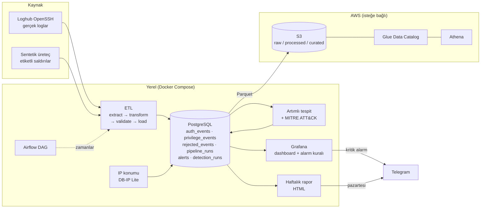
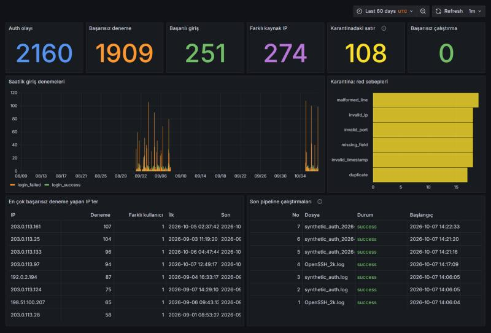
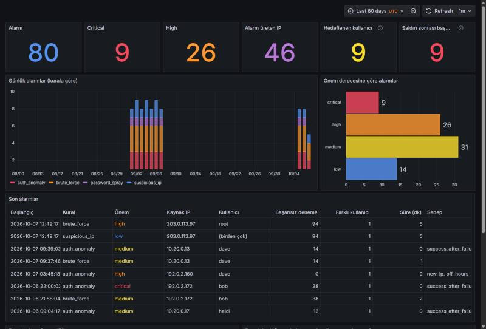
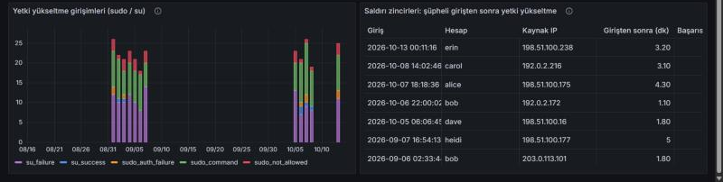
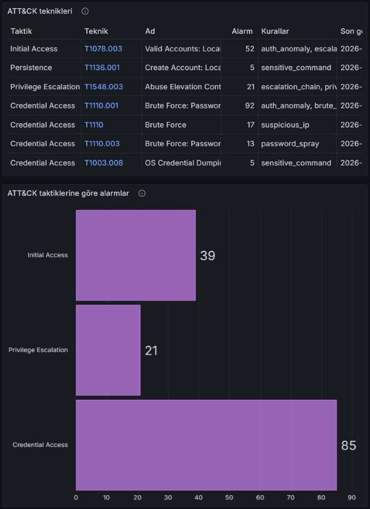
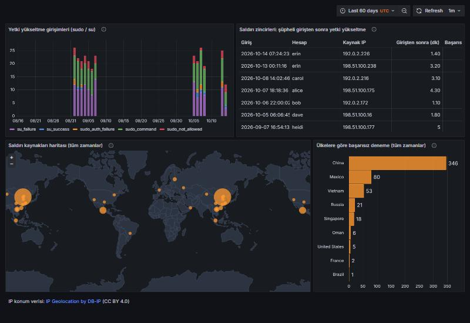
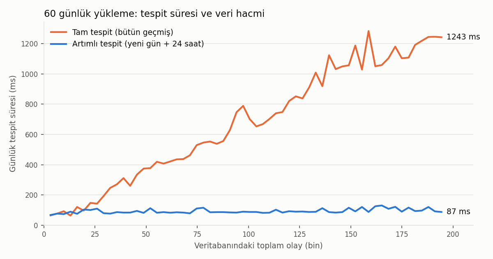

# Cybersecurity Data Lake & Threat Analytics Platform

[](https://github.com/yigitfevzitugrul/Cybersecurity-Data-Lake-Threat-Analytics-Platform/actions/workflows/tests.yml)

Linux kimlik doğrulama loglarını (SSH girişleri ve sudo / su yetki yükseltme denemeleri) toplayan, ETL'den geçiren, veri kalitesini denetleyen, tehditleri kural tabanlı ve artımlı olarak tespit edip MITRE ATT&CK ile etiketleyen, sonuçları Grafana'da gösteren, kritik alarmları ve haftalık raporu Telegram'a gönderen ve veriyi AWS üzerinde bir data lake'e taşıyan uçtan uca bir veri mühendisliği projesi.

Bilişim Sistemleri Mühendisliği bitirme projesi olarak geliştirilmiştir.

## Mimari



| Katman | Teknoloji |
|---|---|
| Dil ve test | Python 3.12, pytest (199 test), GitHub Actions |
| Depolama | PostgreSQL 16; S3 üzerinde Parquet |
| Orkestrasyon | Apache Airflow 2.10 |
| Görselleştirme | Grafana 11 (kod olarak tanımlı veri kaynağı, dashboard'lar ve alarm kuralı) |
| Bildirim | Grafana Alerting + Telegram Bot API (isteğe bağlı) |
| Zenginleştirme | MITRE ATT&CK eşlemesi, DB-IP Lite ile çevrimdışı IP konumu |
| Bulut | AWS S3, Glue Data Catalog, Athena, IAM, Budgets (boto3) |
| Çalışma ortamı | Docker Compose |

Öne çıkanlar:

- **Idempotent pipeline:** aynı ya da örtüşen bir dosyayı tekrar işlemek kayıt çoğaltmaz; hata olursa hiçbir şey yüklenmez.
- **Veri kalitesi:** yedi farklı red sebebi, karantina tablosu ve her çalıştırma için denetim kaydı.
- **Ölçülebilir tespit:** sentetik üreteç saldırıları etiketlediği için kuralların precision ve recall değerleri hesaplanır; sınırları açıkça raporlanır.
- **En az yetki:** Grafana salt-okunur bir veritabanı rolüyle, bulut pipeline'ı kalıcı anahtarı olmayan dar yetkili bir IAM rolüyle çalışır.
- **Saldırı zinciri tespiti:** SSH girişleri ile sudo / su etkinliği birleştirilir; ele geçirilen hesapla yapılan yetki yükseltme ayrı bir kritik alarm olarak yakalanır.
- **MITRE ATT&CK:** her alarm bir taktik ve tekniklerle etiketlenir; dashboard ve rapor ATT&CK sayfalarına bağlanır.
- **Ölçeklenebilir tespit:** artımlı mod yalnızca yeni olayları ve öncesindeki 24 saati okur; 194 bin olayda günlük tespit 1,2 sn yerine 87 ms sürer ve tam tespitle birebir aynı alarmları üretir.
- **Bildirim ve raporlama:** kritik alarmlar dakikalar içinde Telegram'a düşer; her pazartesi biten haftanın HTML raporu üretilip gönderilir.

## Pipeline

```
data/raw/*.log ──extract──▶ transform ──▶ validate ──▶ load ──▶ PostgreSQL
                              │              │           ├─ auth_events      (SSH girişleri)
                              │              │           ├─ privilege_events (sudo / su denemeleri)
                              └──────────────┴──────────▶├─ rejected_events  (karantina + red sebebi)
                                                         └─ pipeline_runs    (her çalıştırmanın denetim kaydı)
                          auth_events + privilege_events ──detect──▶ alerts  (tespit kurallarının alarmları)
                                                       data/processed/*.jsonl
```

| Adım | Dosya | Görev |
|---|---|---|
| Extract | `src/etl/extract.py` | Dosyayı okur, SHA-256 parmak izini çıkarır |
| Transform | `src/etl/transform.py`, `src/etl/parser.py` | Satırları ayrıştırır, IP'yi normalize eder |
| Validate | `src/etl/validate.py` | Veri kalitesi kontrolleri |
| Load | `src/etl/load.py` | Tek transaction'da idempotent yükleme |

Red sebepleri: `malformed_line`, `invalid_timestamp`, `missing_field`, `schema_error`, `invalid_ip`, `invalid_port`, `duplicate`.

Aynı dosyayı (ya da örtüşen bir dosyayı) tekrar işlemek kayıt çoğaltmaz. Hata olursa hiçbir şey yüklenmez ve çalıştırma `failed` olarak kaydedilir.

## Kurulum

Gereksinimler: Docker Desktop, Python 3.12.

```powershell
python -m venv .venv
.venv\Scripts\Activate.ps1
pip install -r requirements.txt
Copy-Item .env.example .env   # içindeki change_me değerlerini değiştir
docker compose up -d --build --wait
```

| Servis | Adres | Giriş |
|---|---|---|
| Airflow | http://localhost:8080 | `admin` / `.env` içindeki `AIRFLOW_ADMIN_PASSWORD` |
| Grafana | http://localhost:3000 | `admin` / `.env` içindeki `GRAFANA_ADMIN_PASSWORD` |
| PostgreSQL | `localhost:5433` | `.env` içindeki `POSTGRES_USER` / `POSTGRES_PASSWORD` |

Grafana veritabanına sadece `SELECT` yetkisi olan ayrı bir rolle (`grafana_ro`) bağlanır. Veri kaynağı ve dashboard'lar `grafana/` klasöründen otomatik yüklenir.



## Airflow DAG'i

`auth_log_etl` her gün çalışır:

```
generate_daily_log ──▶ run_etl ──┬──▶ quality_gate
                                 ├──▶ enrich_geoip
                                 └──▶ detect_threats ──▶ sync_to_cloud ──▶ reconcile_cloud
```

- `generate_daily_log`: gerçek bir log kaynağını taklit eder; o gün için gömülü saldırılar ve %2 bozuk satır içeren sentetik bir log üretir.
- `run_etl`: `data/raw/` altındaki henüz işlenmemiş bütün `*.log` dosyalarını pipeline'dan geçirir. Bir dosyanın işlenip işlenmediğine içeriğinin SHA-256 özetine bakarak karar verir.
- `quality_gate`: bir dosyada reddedilen satır oranı %10'u aşarsa DAG'i başarısız sayar.
- `detect_threats`: tespit kurallarını çalıştırır ve alarmları `alerts` tablosuna yazar.
- `sync_to_cloud` ve `reconcile_cloud`: katmanları S3'e gönderir, ardından yerel veritabanı ile Athena'nın aynı satır sayılarını verdiğini doğrular. Varsayılan kurulumda bu iki adım atlanır; bkz. [DAG'den buluta gönderme](#dagden-buluta-gönderme).

DAG ilk kurulumda duraklatılmış gelir. Arayüzden açabilir ya da komut satırından tetikleyebilirsin:

```powershell
docker compose exec airflow-scheduler airflow dags unpause auth_log_etl
docker compose exec airflow-scheduler airflow dags trigger auth_log_etl
```

### Haftalık güvenlik raporu

`weekly_security_report` DAG'i her pazartesi 06:00'da (UTC) biten haftanın raporunu üretir (`build_report → send_report`). Rapor, internet bağlantısı gerektirmeyen tek dosyalık bir HTML'dir; aynı sayılar JSON olarak da yazılır (`data/curated/reports/weekly_<pazartesi>.html` / `.json`):

- temel sayılar ve önceki haftaya göre değişim (başarısız deneme, saldıran IP, başarılı giriş, alarm, kritik alarm, başarısız yetki girişimi),
- günlük başarısız deneme grafiği,
- önem derecesi ve kurala göre alarmlar, MITRE ATT&CK teknikleri, kritik alarmların listesi,
- en çok saldıran IP'ler (ülkesiyle) ve en çok hedeflenen kullanıcı adları,
- yetki yükseltme girişimleri ve hassas sudo komutları,
- o haftanın verisini yükleyen pipeline çalıştırmalarının veri kalitesi (red oranı ve sebepleri).

Telegram ayarlıysa ([Telegram bildirimi](#telegram-bildirimi)) rapor, kısa bir özetle birlikte dosya olarak gönderilir; değilse `send_report` atlanır. Logdan gelen bütün değerler (ör. saldırganın denediği kullanıcı adları) HTML'e kaçışlanarak yazılır.

```powershell
python -m src.reporting.weekly                          # son tamamlanan hafta
python -m src.reporting.weekly --week-ending 2026-10-12 # 2026-10-05 – 2026-10-11 haftası
python -m src.reporting.weekly --telegram               # Telegram'a da gönder
```

## Tehdit tespiti

Kurallar `src/detection/rules.py` içinde, eşikler [config/detection_rules.yaml](config/detection_rules.yaml) dosyasındadır.

| Kural | Ne arar | Varsayılan eşik |
|---|---|---|
| `brute_force` | Aynı IP'den aynı kullanıcıya kısa sürede çok başarısız deneme | 5 dakikada 10 deneme |
| `password_spray` | Aynı IP'den çok farklı kullanıcıya, her birine az deneme | 30 dakikada 10 kullanıcı, kullanıcı başına ortalama en fazla 3 deneme |
| `suspicious_ip` | `root` ya da var olmayan kullanıcılara yönelik denemeler; çok sunucuyu yoklayan IP | 60 dakikada 5 deneme ya da 3 farklı sunucu |
| `auth_anomaly` | Olağandışı başarılı giriş: çok başarısızlıktan sonra giriş, kullanıcı için yeni IP, mesai dışı saat | 5 başarısız deneme / 3 girişlik geçmiş / 07:00–20:00 dışı |
| `privilege_abuse` | Aynı kullanıcının art arda başarısız yetki girişimleri: yanlış sudo parolası, sudo yetkisi olmadan sudo, başarısız su | 10 dakikada 3 başarısız girişim |
| `sensitive_command` | sudo ile çalıştırılan hassas komutlar: `/etc/shadow`, sudoers, kullanıcı yönetimi, setuid | Komut kalıpları ayar dosyasında |
| `escalation_chain` | **Saldırı zinciri:** şüpheli bir girişin (`auth_anomaly` high / critical) ardından aynı hesapla yapılan sudo / su etkinliği | Girişten sonraki 60 dakika |

sudo / su kayıtlarında kaynak IP bulunmaz. Bu yüzden `escalation_chain`, SSH girişini ve yetki denemesini hesap adı ve zaman üzerinden bağlar; alarm, girişin geldiği IP'yi taşır.

```powershell
python -m src.detection.engine            # artımlı: yalnızca yeni olaylar + öncesindeki 24 saat
python -m src.detection.engine --full     # bütün geçmişi yeniden değerlendir
python -m src.detection.engine --reset    # eşik değiştirdikten sonra: eski alarmları silip yeniden üret
python -m src.detection.evaluate          # doğruluğu sentetik etiketlere karşı ölç
```

Tespit artımlıdır (bkz. [Ölçeklenebilirlik](#ölçeklenebilirlik)); aynı alarm ikinci kez eklenmez, güncellenir. Her çalıştırma `detection_runs` tablosuna kaydedilir.



### Doğruluk ölçümü

Sentetik üreteç her saldırıyı etiketlediği için kuralların doğruluğu ölçülebilir. Üreteç `--hard-cases` ile kuralları bilerek zorlayan iki durum da ekler: eşiklerin altında kalan **yavaş brute force** ve şifresini unutup kendi IP'sinden art arda yanlış deneme yapan **gerçek kullanıcı**.

10 günlük sentetik veri (50 etiketli saldırı, 84 alarm) üzerindeki sonuç:

| Saldırı tipi | Beklenen kural | Yakalanan | Recall |
|---|---|---|---|
| Brute force | `brute_force` | 10/10 | %100 |
| Password spraying | `password_spray` | 10/10 | %100 |
| Başarısızlıklar sonrası başarılı giriş | `auth_anomaly` | 10/10 | %100 |
| Gece saatinde yeni IP'den giriş | `auth_anomaly` | 10/10 | %100 |
| Yavaş brute force | `brute_force` | 0/10 | %0 |

| Kural | Doğru alarm | Precision |
|---|---|---|
| `brute_force` | 20/30 | %66,7 |
| `password_spray` | 10/10 | %100 |
| `suspicious_ip` | 14/14 | %100 |
| `auth_anomaly` | 20/30 | %66,7 |

Genel recall %80, precision %76,2. Önem derecesi `high` ya da `critical` olan 37 alarmın tamamı gerçek saldırıdır.

Bu sonuçlar kural tabanlı tespitin bilinen sınırlarını gösterir:

- Yavaş brute force, kayan pencere eşiğinin altında kaldığı için `brute_force` kuralıyla yakalanamaz. Hedef `root` olduğunda `suspicious_ip` kuralı yine de alarm üretir (saldırıların %84'ü en az bir kuralla yakalanır).
- Yanlış alarmların tamamı şifresini unutan kullanıcıdan gelir. `auth_anomaly`, giriş kullanıcının bilinen IP'sinden geldiğinde önem derecesini `medium`'a düşürür; `brute_force` ise kullanıcı geçmişine bakmadığı için bunu ayırt edemez.
- Sonuçlar sentetik veriye aittir; gerçek trafikte oranlar farklı olacaktır. Loghub verisinin etiketi olmadığı için ölçüme girmez.

### Yetki yükseltme tespiti

Üreteç `--privilege` ile yöneticilerin olağan sudo komutlarını ve iki saldırı türünü ekler:

- **privilege_escalation:** o günün "başarısızlıklar sonrası başarılı giriş" saldırısında ele geçirilen hesapla, girişten birkaç dakika sonra sudo / su denemesi. Hesap yöneticiyse saldırgan parolayı bildiği için komutlar çalışır (`/etc/shadow` okuma, root yetkili gizli kullanıcı ekleme); değilse sudo reddedilir ve root parolası denenir.
- **su_bruteforce:** sudo yetkisi olmayan bir kullanıcının art arda root parolası denemesi.

`--hard-cases` ile iki zararsız benzer de eklenir: sudo yetkisi olmayan yeni bir çalışanın tek bir sudo denemesi ve bir yöneticinin akşam saatinde açtığı root kabuğu.

Geliştirme veritabanındaki 12 günlük veride (12 privilege_escalation, 12 su_bruteforce):

| Saldırı tipi | Beklenen kural | Yakalanan |
|---|---|---|
| Ele geçirilen hesapla yetki yükseltme | `escalation_chain` | 12/12 |
| İçeriden root parolası denemesi | `privilege_abuse` | 12/12 |

| Kural | Doğru alarm |
|---|---|
| `privilege_abuse` | 19/19 |
| `sensitive_command` | 5/5 |
| `escalation_chain` | 12/12 |

Zararsız benzerler (yeni çalışanın tek sudo denemesi, yöneticinin root kabuğu) alarm üretmedi. Aynı ölçüm üç farklı tohumla üretilmiş 10'ar günlük veride de tekrarlandı; birinde `escalation_chain` bir yanlış alarm verdi: şifresini unutup ilk kez giriş yapan bir yönetici, hemen ardından olağan bir sudo komutu çalıştırdı. Kullanıcının geçmişi henüz olmadığı için giriş şüpheli sayıldı ve zincir kuruldu.



### MITRE ATT&CK eşlemesi

Her alarm bir [MITRE ATT&CK](https://attack.mitre.org) taktiği ve bir ya da birkaç teknikle etiketlenir (`alerts.mitre_tactic`, `alerts.mitre_techniques`). Eşleme [src/detection/mitre.py](src/detection/mitre.py) içindedir; teknik adları ve bağlantıları `attack_techniques` tablosuna yazılır.

| Kural | Teknik | Taktik |
|---|---|---|
| `brute_force` | T1110.001 Password Guessing | Credential Access |
| `password_spray` | T1110.003 Password Spraying | Credential Access |
| `suspicious_ip` | T1110 Brute Force | Credential Access |
| `auth_anomaly` | T1078.003 Valid Accounts: Local Accounts (+ T1110.001, giriş başarısızlıklardan sonra geldiyse) | Initial Access |
| `privilege_abuse` | T1548.003 Sudo and Sudo Caching (sudo hataları), T1110.001 (su ile parola denemesi) | Privilege Escalation / Credential Access |
| `sensitive_command` | Komuta göre: T1003.008 `/etc/shadow`, T1548.003 sudoers, T1136.001 hesap ekleme, T1098 hesap değiştirme, T1548.001 setuid | Eşleşen ilk tekniğin taktiği |
| `escalation_chain` | T1078.003 + T1548.003 / T1110.001 | Privilege Escalation |

ATT&CK bazı teknikleri birden çok taktiğe bağlar (ör. Valid Accounts dört taktikte geçer). Burada her teknik, bu projedeki bağlamına uyan tek taktikle kayıtlıdır: dışarıdan SSH ile geçerli bir hesapla giriş Initial Access sayılır. `sensitive_command` kalıpları ayar dosyasında teknik kimliğine göre gruplanmıştır; yeni bir kalıp eklerken tekniği de seçilir.

Güvenlik dashboard'unda alarmların taktiklere dağılımı ve teknik tablosu bulunur; teknik kimliğine tıklayınca ATT&CK sayfası açılır.



### Telegram bildirimi

İsteğe bağlı olarak, tespit motoru yeni bir **critical** alarm yazdığında Grafana Telegram'a mesaj gönderir: kural, kaynak IP, hesap, ATT&CK teknikleri ve saldırı zamanı. Grafana kuralı dakikada bir çalışır ve alarmın saldırı zamanına değil **yazıldığı** zamana (`first_detected_at`) bakar; böylece geriye dönük yüklenen günlerdeki saldırılar da bildirilir. Aynı anda gelen alarmlar tek mesajda toplanır.

Kurulum (bir kez):

1. Telegram'da **@BotFather** ile bir bot oluşturun (`/newbot`) ve verdiği token'ı `.env` dosyasına `TELEGRAM_BOT_TOKEN=...` olarak ekleyin.
2. Botunuzu açıp ona bir mesaj yazın (botlar kendilerine yazmamış birine mesaj gönderemez).
3. Sohbet kimliğini bulup Grafana bildirim kanalı dosyasını üretin ve deneme mesajı gönderin:

```powershell
python -m src.utils.telegram_setup --test
docker compose -f docker-compose.yml -f docker-compose.alerting.yml up -d --wait
```

Kural, şablon ve bildirim politikası [grafana/alerting/critical_alerts.yaml](grafana/alerting/critical_alerts.yaml) dosyasındadır. Bildirim kanalı yerel bir dosyaya (`grafana/alerting/telegram_contact_point.local.yaml`, git'e girmez) yazılır; token o dosyada da bulunmaz, Grafana onu ortam değişkeninden okur. Varsayılan kurulumda (yalnızca `docker-compose.yml`) bildirim yoktur.

## Coğrafi konum

Kaynak IP'ler ücretsiz [DB-IP Lite](https://db-ip.com) veritabanıyla ülke, şehir ve koordinata eşlenir. Veritabanı bir kez indirilir ve IP'ler bilgisayarda çözülür; hiçbir adres dışarıdaki bir servise gönderilmez, API anahtarı ya da ücret gerekmez.

```powershell
python -m src.enrichment.download_geoip   # veritabanını data/reference/ altına indirir (~120 MB, aylık güncellenir)
python -m src.enrichment.geoip            # yeni IP'leri çözer; --refresh hepsini yeniden çözer
```

DAG'deki `enrich_geoip` adımı yeni IP'leri her gün çözer; veritabanı dosyası yoksa adım atlanır. Güvenlik dashboard'unda saldırı kaynaklarının dünya haritası ve ülkelere göre başarısız denemeler gösterilir. Harita altlığı Grafana'nın içinde gelen ülke sınırları dosyasıdır; internet ya da harita servisi anahtarı gerektirmez.



- Sentetik verideki adresler belgeleme bloklarından seçildiği için konumları yoktur; haritada yalnızca gerçek Loghub saldırganları görünür (25 IP; en çok Çin, Meksika ve Vietnam).
- Konum bugünkü veritabanına göredir; eski loglardaki bir IP o tarihte başka bir yerde olabilir.

IP konum verisi: IP Geolocation by DB-IP, [CC BY 4.0](https://creativecommons.org/licenses/by/4.0/).

## Ölçeklenebilirlik

Tespit motoru her çalıştırmada bütün geçmişi okusaydı, süresi veriyle doğrusal büyürdü. Bu yüzden varsayılan mod **artımlıdır**:

- Son çalıştırmanın gördüğü en büyük olay kimlikleri (`detection_runs` tablosu) filigran olarak tutulur; ondan büyük kimlikli olaylar "yeni"dir. Kimlik kullanıldığı için geç gelen eski tarihli bir log dosyası da yakalanır.
- Yeni olayların en erkeninden **24 saat öncesine** kadar olan olaylar okunur (`config/detection_rules.yaml` → `incremental.lookback_hours`); bütün kural pencereleri bundan çok kısadır.
- `auth_anomaly`'nin ihtiyaç duyduğu "kullanıcı bu IP'den daha önce girdi mi?" geçmişi, pencereden öncesi için SQL ile özetlenir.
- Yalnızca yeni olaylara dokunabilen alarmlar yazılır; alarmlar ve çalıştırma kaydı tek transaction'dadır.

Doğruluğu bir testle güvenceye alınır: günler tek tek (biri sırasından geç) yüklenip her seferinde artımlı tespit çalıştırıldığında, sonuç bütün geçmişin tek seferde değerlendirilmesiyle **birebir aynıdır** (`test_incremental_detection_matches_full_detection`).

Ölçüm aracı, üreteçle yoğun internet gürültülü bir veri seti oluşturup günleri Airflow'un yaptığı gibi sırayla yükler; her günden sonra iki ayrı geçici şemada artımlı ve tam tespiti çalıştırır. Geliştirme verisine dokunmaz.

```powershell
python -m src.benchmark.scale --days 60 --noise 1500   # sonuç: data/curated/benchmark.json
```

60 gün, günde ~1500 gürültü IP'si (565 bin log satırı, 194 bin olay, 4279 alarm) üzerindeki sonuç ([docs/benchmark/benchmark_60d.json](docs/benchmark/benchmark_60d.json)):

| Ölçüm | Sonuç |
|---|---|
| ETL hızı (parse + doğrulama + yükleme) | medyan ~27.500 satır/sn, gün başına ~0,35 sn |
| Son gün tespit süresi | artımlı **87 ms** (6.386 olay okur), tam **1.243 ms** (194.315 olay okur), ~14 kat |
| 60 günün toplam tespit süresi | artımlı 5,5 sn, tam 40,7 sn |
| Artımlı ve tam tespitin alarmları | aynı (4279 alarm) |
| Depolama | ham log 52,6 MB → Parquet 19,3 MB (2,7 kat, gün başına bir dosya) |



Artımlı tespitin süresi veri hacmine değil, günlük olay sayısına bağlıdır; tam tespit ise doğrusal büyür. Ölçüm tek bir dizüstü bilgisayarda, Docker içindeki PostgreSQL ile yapıldı; mutlak süreler makineye göre değişir, oran ve eğilim önemlidir. Parquet oranı ılımlıdır çünkü her satır sıkıştırılamayan 64 karakterlik `event_hash` taşır; ham logdaki ilgisiz satırlar ise Parquet'e hiç girmez.

## AWS Data Lake

Yerel katmanlar aynı mantıkla S3'e taşınır ve Athena ile sorgulanır:

```
s3://<bucket>/
├── raw/auth_logs/<dosya>.log                               ham loglar
├── processed/auth_events/event_date=YYYY-MM-DD/*.parquet   doğrulanmış olaylar (güne göre bölümlü)
├── processed/privilege_events/event_date=YYYY-MM-DD/      sudo / su olayları (güne göre bölümlü)
├── curated/alerts/, curated/daily_ip_summary/              alarmlar ve günlük IP özeti
└── athena-results/                                         sorgu sonuçları (7 gün sonra silinir)
```

| Bileşen | Ne yapıldı |
|---|---|
| S3 | Herkese açık erişim kapalı, sunucu tarafı şifreleme, TLS dışı istekler bucket politikasıyla reddedilir |
| Glue Data Catalog | `auth_events`, `privilege_events`, `alerts`, `daily_ip_summary` tabloları. Bölümler *partition projection* ile S3 yolundan hesaplanır; crawler çalıştırmak gerekmez |
| Athena | Ayrı workgroup; sorgu başına en fazla 100 MB taranabilir (maliyet koruması) |
| IAM | Pipeline, kalıcı erişim anahtarı olmayan bir rolü üstlenir (`sts:AssumeRole`, 1 saatlik geçici kimlik). Yetkileri [infra/iam/pipeline_policy.json](infra/iam/pipeline_policy.json) dosyasındadır |
| Budgets | Aylık maliyet bütçesi; gerçekleşen harcama %80'i ya da tahmin %100'ü aşınca e-posta |

Pipeline rolü sadece kendi bucket'ındaki üç katmana yazabilir, Glue kataloğunu okuyabilir ve kendi workgroup'unda sorgu çalıştırabilir. Nesne silemez, başka bucket'ları göremez, tablo ya da IAM ayarı değiştiremez.

Kurulum için `aws configure` ile yapılandırılmış yönetici yetkili bir AWS kimliği gerekir. `.env` içindeki AWS ayarlarını doldurduktan sonra:

```powershell
python -m src.cloud.setup          # altyapıyı kurar; çıktıdaki rol ARN'ını .env'e yaz
python -m src.cloud.sync           # raw / processed / curated katmanlarını S3'e gönderir
python -m src.cloud.athena sql/athena/01_lake_analysis.sql
python -m src.cloud.verify_access  # rolün en az yetkiyle çalıştığını canlı doğrular
python -m src.cloud.reconcile      # yerel veritabanı ile Athena'yı karşılaştırır
```

`setup` ve `sync` tekrar çalıştırılabilir: var olan kaynaklar güncellenir, içeriği değişmemiş nesneler yeniden yüklenmez.

Maliyet: bu veri boyutunda (yaklaşık 1 MB) S3, Glue kataloğu ve Athena sorguları pratikte ücretsizdir; örnek analiz dosyasının tamamı 17 KB veri tarar. Bucket kullanılmadığı dönemde silinebilir; `setup` ve `sync` ile birkaç dakikada yeniden oluşturulur.

### DAG'den buluta gönderme

Varsayılan kurulumda konteynerlerde AWS kimliği bulunmaz ve DAG'in bulut adımları atlanır. Açmak için servisleri ek dosyayla başlat:

```powershell
docker compose -f docker-compose.yml -f docker-compose.cloud.yml up -d --wait
```

[docker-compose.cloud.yml](docker-compose.cloud.yml), makinedeki `~/.aws` klasörünü Airflow konteynerlerine salt-okunur bağlar. DAG bu kimlikle yalnızca en az yetkili pipeline rolünü üstlenir. Kapatmak için servisleri ek dosya olmadan yeniden başlatmak yeterlidir.

Kaynakları kaldırmak için:

```powershell
aws s3 rb s3://<bucket> --force
aws glue delete-database --name security_lake
aws athena delete-work-group --work-group secdl --recursive-delete-option
aws iam delete-role-policy --role-name secdl-pipeline --policy-name secdl-pipeline-access
aws iam delete-role --role-name secdl-pipeline
aws budgets delete-budget --account-id <hesap-no> --budget-name secdl-monthly
```

## Kullanım

Gerçek veri: [Loghub OpenSSH_2k.log](https://github.com/logpai/loghub/tree/master/OpenSSH) dosyasını `data/raw/` altına koy. Syslog satırında yıl yoktur; `--year` verilmezse dosyanın değişiklik tarihinden tahmin edilir.

```powershell
python -m src.etl.pipeline data/raw/OpenSSH_2k.log --year 2025
```

Sentetik veri: gömülü saldırılar (brute force, password spraying, başarısızlıklar sonrası başarılı giriş, gece saatinde yeni IP'den giriş), isteğe bağlı bozuk satırlar (`--bad-ratio`) ve kuralları zorlayan durumlar (`--hard-cases`) içerir. Saldırı etiketleri `data/raw/synthetic_auth_labels.json` dosyasına yazılır.

```powershell
python -m src.generator.generate --start-date 2026-09-01 --days 7 --seed 42 --bad-ratio 0.02 --hard-cases --privilege
python -m src.etl.pipeline data/raw/synthetic_auth.log --year 2026
```

Analiz sorguları:

```powershell
cmd /c "docker compose exec -T postgres psql -U secdl -d security_lake < sql\analysis\01_basic_analysis.sql"
cmd /c "docker compose exec -T postgres psql -U secdl -d security_lake < sql\analysis\02_data_quality.sql"
```

## Testler

```powershell
python -m pytest -q
```

Veritabanı testleri geçici bir şemada çalışır ve geliştirme verisine dokunmaz; PostgreSQL kapalıysa atlanır. Bulut testleri AWS'ye bağlanmaz. Aynı testler her push'ta GitHub Actions üzerinde, gerçek bir PostgreSQL servisiyle çalışır.

## Proje yapısı

```
config/detection_rules.yaml    tespit kurallarının eşikleri
dags/auth_log_etl.py           günlük ETL + tespit DAG'i
dags/weekly_security_report.py haftalık rapor DAG'i
docker/                        Airflow imajı ve veritabanı ilk kurulum betiği
grafana/                       veri kaynağı, dashboard ve Telegram bildirim tanımları
infra/iam/                     pipeline rolünün IAM politikası
sql/schema/                    tablo tanımları (sırayla uygulanır)
sql/analysis/, sql/athena/     PostgreSQL ve Athena analiz sorguları
src/generator/                 sentetik log üreteci
src/etl/                       extract, parser, transform, validate, load, pipeline
src/detection/                 kurallar, artımlı tespit motoru, MITRE ATT&CK eşlemesi, doğruluk ölçümü
src/benchmark/                 ölçeklenebilirlik testi
src/reporting/                 haftalık güvenlik raporu
src/utils/                     veritabanı bağlantısı, Telegram yardımcıları ve kurulumu
src/cloud/                     AWS kurulumu, S3 senkronu, Athena, tutarlılık kontrolü
tests/                         pytest testleri
data/{raw,processed,curated}/  yerel veri katmanları (git'e girmez)
```

## Bilinen sınırlar

- Tespit kural tabanlıdır: eşiklerin altında kalan yavaş saldırıları kaçırır, şifresini unutan kullanıcıyı saldırıdan ayıramaz (bkz. [Doğruluk ölçümü](#doğruluk-ölçümü)).
- Artımlı tespit 24 saatlik geriye bakış penceresi kullanır; 24 saatten uzun süren ve aralarında kural penceresinden kısa boşluklar olan bir saldırı oturumu artımlı modda bölünebilir. Gerekirse `--full` bütün geçmişi yeniden değerlendirir.
- Syslog satırlarında yıl yoktur. Yıl dosya tarihinden tahmin edilir; bir yıldan eski ya da yıl sınırını aşan dosyalarda `--year` elle verilmelidir.
- Yalnızca SSH `Failed` / `Accepted` satırları ve sudo / su kayıtları olay sayılır. sudo kullanmadan yapılan yetki yükseltmeleri (ör. bir açığın sömürülmesi) bu kayıtlarda görünmez; onlar için `auditd` gibi bir kaynak gerekir.
- sudo / su kayıtlarında kaynak IP olmadığı için saldırı zinciri hesap adı ve zamanla kurulur; aynı hesabı aynı anda kullanan meşru bir oturum zincire karışabilir.
- Doğruluk sonuçları sentetik veriye aittir. Gerçek Loghub verisinin etiketi olmadığı için ölçüme girmez.
